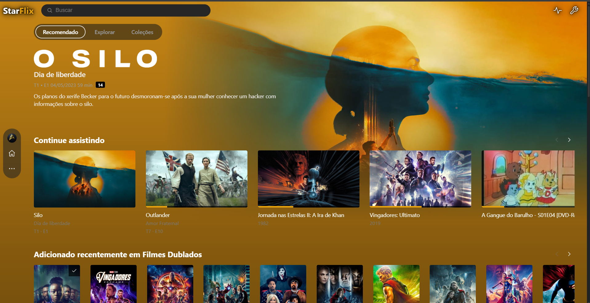
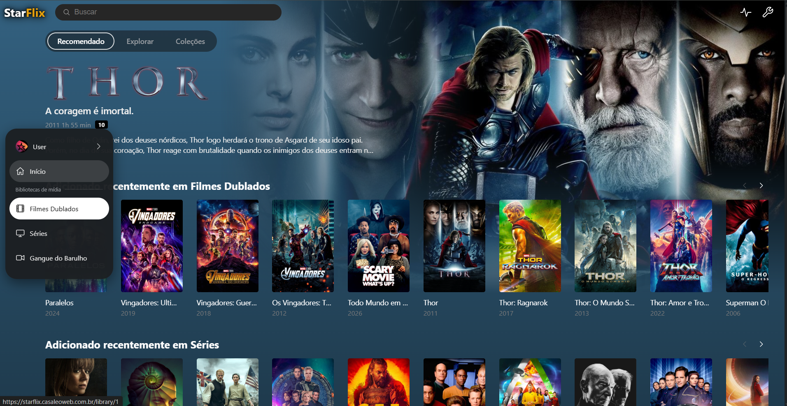
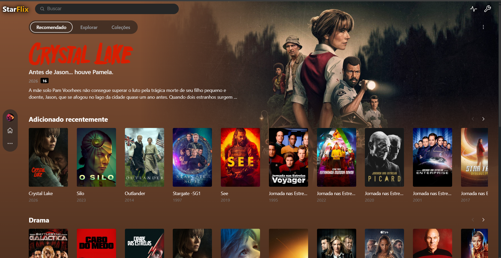
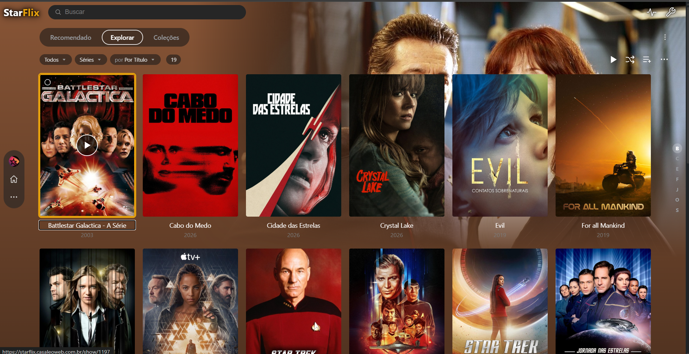
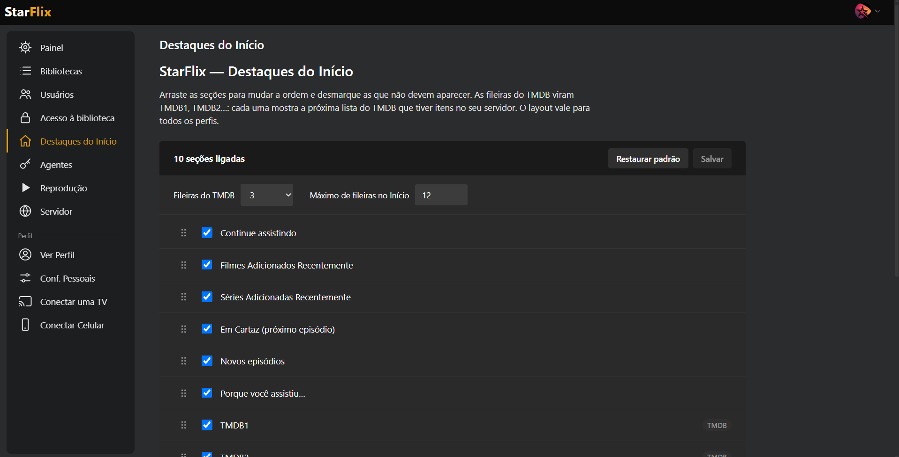
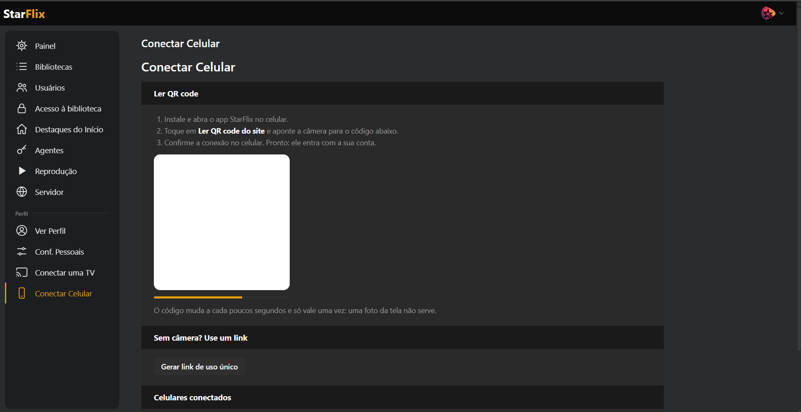

<div align="center">


### Seu servidor de vídeo. Sua casa. Suas regras.

Um servidor de mídia **próprio, local e sem nuvem**, com visual e estilo próprio e moderno,<br>
app para **celular** e **Android TV**, tudo numa única porta (padrão **32000**, configurável).

<br>


[Recursos](#-recursos) •
[Capturas](#-capturas-de-tela) •
[Instalação](#-instalação) •
[Apps Android](#-apps-android) •
[Configuração](#-configuração) •
[Idiomas](#-idiomas) •
[Estrutura](#-estrutura-do-projeto) •
[Roadmap](#-roadmap)

</div>

---

## ✨ Por que StarFlix?

|||
|-|-|
|🏠 **100% local**|Sem relay, sem Tailscale, sem Headscale, sem conta em serviço de terceiros. Porta padrão **32000**, configurável em **Configurações → Servidor**.|
|🎬 **Visual Próprio**|Tema escuro, destaque dourado `#e5a00d`, barra lateral dinâmica, Início personalizável e página de detalhes completa.|
|📱 **Apps nativos**|Um único APK para **celular** (WebView + player nativo) e **Android TV** (Compose for TV, controle por D-pad).|
|🔍 **Conexão automática**|Os apps encontram o servidor sozinhos na rede (mDNS) ou pareiam por **QR code**.|
|🪶 **Leve**|Flask + SQLite + FFmpeg. Sem Docker, sem venv, sem banco externo.|
|🌍 **10 idiomas**|Site, servidor e apps com várias opções de idioma, com troca instantânea em **Configurações**. Padrão pt-BR. Metadados (TMDB, TheTVDB, SubDL) seguem o idioma escolhido.|

---

## 🎯 Recursos

### 📚 Bibliotecas e metadados

* Bibliotecas de **Filmes**, **Séries** e **Outros Vídeos**, com várias pastas por biblioteca.
* Scanner automático: extrai `Título (Ano)` e `SxxExx` do nome do arquivo, com varredura periódica configurável.
* `ffprobe` registra duração, codecs, faixas de áudio e legendas.
* Metadados via **TMDB** e **TheTVDB**, notas **IMDb / Rotten Tomatoes** via OMDb (opcional).
* Correção manual de correspondência, edição de capas, tags e informações.
* Detecção de **duplicatas**, **coleções** manuais e automáticas, **listas de reprodução** e listas inteligentes.
* Páginas de **ator e diretor** e página dedicada de **episódio**.

### ▶️ Reprodução

* **Direct play** com suporte a Range, **remux** ou **transcode**, escolhidos automaticamente.
* **HLS** e **DASH** via FFmpeg, com seleção de qualidade, faixa de áudio e legenda.
* **Legendas** externas (`.srt` → `.vtt`) e embutidas, com **busca automática pelo SubDL** e estilo por perfil.
* **Pular abertura e créditos** com detecção automática de marcadores e marcação manual.
* **Miniaturas na barra de progresso** (trickplay).
* **HDR → SDR** com tone-mapping em CPU.
* **Versões otimizadas** para reduzir uso de CPU.
* Controle de transcodes simultâneos, espaço livre mínimo e limpeza automática de sessões.
* Progresso sincronizado, **Continuar assistindo**, próximo episódio automático e marcação de assistido.

### 👥 Usuários e acesso

* Primeiro admin criado na primeira execução; senhas com hash.
* **Perfis** por usuário (nome + avatar), com preferências de idioma, áudio e legenda.
* Acesso por biblioteca definido pelo administrador.
* Gerenciamento de **aparelhos**, sessões e revogação.

### 🛠️ Painel do administrador

* Gerenciamento completo de bibliotecas, usuários e acessos.
* **Painel** com atividade do servidor, aparelhos e indicador de varredura.
* **Backup automático** do banco (a cada N dias, configurável) e script de restauração.
* Configuração das chaves de API direto na interface (**Configurações → Agentes**); o idioma dos agentes é o do usuário, sem opção por agente nem por biblioteca.
* Personalização de marca (branding).

### 🏡 Início dinâmico

* Fileiras do Início configuráveis, com **Destaques** em tela cheia.
* Listas do TMDB por região, Continuar assistindo, adicionados recentemente e uso recente.
* Barra lateral dinâmica: bibliotecas nas páginas normais e menus de administração nos ícones da barra superior.

---

## 📸 Capturas de tela

<div align="center">

 
 
 

</div>

## 📱 Apps Android

Um único APK Android com duas experiências:

|📱 Celular|📺 Android TV / Google TV|
|-|-|
|Tela de conexão → WebView + player nativo (ExoPlayer)|Interface nativa em **Compose for TV**|
|Descoberta automática (mDNS), **QR code**, link `starflix://connect` ou endereço manual|Descoberta automática, **pareamento por QR** ou código de 6 caracteres em `/tv`|
|PiP, orientação paisagem, barra inferior flutuante|Controle total pelo **D-pad**, linha **Reproduzir a seguir** no launcher|

### Gerar o APK

Requer **JDK 17** e **Android SDK**.

```bash
./scripts/build_apk.sh      # gera ./starflix.apk (assinado)
```

> O script cria `android/starflix.jks` e `android/keystore.properties` na primeira execução. **Guarde os dois**: sem eles não é possível atualizar o app instalado.

### Instalar na TV

```bash
adb connect IP-DA-TV:5555
adb install -r starflix.apk
```

Detalhes de uso, controle remoto e launcher em [`android/README.md`](android/README.md).

---

## 🚀 Instalação

Um único comando baixa o projeto, instala as dependências, cria o serviço systemd e sobe o servidor.

```bash
curl -fsSL https://raw.githubusercontent.com/LeonardoCruzRJ/starflix/main/install.sh | sudo bash
```

Ao terminar, abra **`http://IP-DO-SERVIDOR:32000`** (ou a porta que você escolheu em **Configurações → Servidor**), crie o usuário administrador e adicione suas bibliotecas em **Configurações**.

**O instalador:**

1. instala o servidor Starflix;
2. Utiliza a pasta **`/data/starflix`** como padrão do projeto;
3. instala as dependências Python (`requirements.txt`);
4. cria as pastas de `data/` e instala `starflix.service` com o caminho correto;
5. ativa o serviço no boot, inicia e confere `/health`.

**Opções** (variáveis de ambiente antes do comando):

|Variável|Padrão|Descrição|
|-|-|-|
|`STARFLIX_DIR`|`/data/starflix`|Pasta de instalação|
|`STARFLIX_BRANCH`|`main`|Branch a instalar|
|`STARFLIX_REPO`|repositório oficial|URL do repositório (fork)|

```bash
# exemplo: instalar em outra pasta
curl -fsSL https://raw.githubusercontent.com/LeonardoCruzRJ/starflix/main/install.sh | sudo STARFLIX_DIR=/opt/starflix bash
```

### Atualizar

Rode o mesmo comando, com atenção se houver troca da pasta padrão: o instalador atualiza as dependências e reinicia o serviço. `data/` (banco, capas, backups) e `scripts/.env` são preservados.

### Comandos úteis

```bash
systemctl status starflix        # estado
journalctl -u starflix -f        # logs
sudo systemctl restart starflix  # reiniciar
python3 /data/starflix/scripts/smoke_test.py   # teste de fumaça
```

<details>
<summary><b>Instalação manual</b></summary>

Requisitos: Linux, Python 3.10+, `ffmpeg` e `ffprobe` no `PATH`.

```bash
sudo apt install -y git python3 python3-pip ffmpeg
sudo git clone https://github.com/LeonardoCruzRJ/starflix.git /data/starflix
cd /data/starflix
sudo pip3 install --break-system-packages -r requirements.txt
python3 run.py            # teste rápido; Ctrl+C para sair

# serviço systemd
sudo sed "s|@DIR@|$(pwd)|g" scripts/starflix.service | sudo tee /etc/systemd/system/starflix.service >/dev/null
sudo systemctl daemon-reload && sudo systemctl enable --now starflix
```

</details>

---

## ⚙️ Configuração

Variáveis de ambiente (opcionais), lidas de `scripts/.env` pelo serviço systemd:

|Variável|Padrão|Descrição|
|-|-|-|
|`STARFLIX_DATA`|`./data`|Pasta de dados (banco, capas, transcode, legendas, backups)|
|`STARFLIX_SECRET`|gerado em `data/secret.key`|Chave de sessão|
|`STARFLIX_MAX_TRANSCODES`|`3`|Transcodes FFmpeg simultâneos (`0` = sem limite)|
|`STARFLIX_MIN_FREE_GB`|`5`|Espaço livre mínimo em `data/transcode`|
|`STARFLIX_THREADS`|`64`|Threads do servidor|
|`STARFLIX_SCAN_INTERVAL`|`3600`|Segundos entre varreduras automáticas (`0` desativa)|
|`STARFLIX_TRANSCODE_TTL`|`600`|Segundos sem atividade até apagar uma sessão de transcode|
|`STARFLIX_TRANSCODE_CLEAN_INTERVAL`|`60`|Intervalo da limpeza de sessões|
|`TMDB_IMG_SIZE`|`w500`|Tamanho das capas baixadas do TMDB|

### Chaves de API para os Agentes de Metadados

As chaves ficam **dentro das configurações**. Configure em **Configurações → Agentes**:

|Serviço|Uso|Obrigatória|
|-|-|-|
|[TMDB](https://www.themoviedb.org/settings/api)|Filmes, séries, capas, listas do Início|Recomendada|
|[TheTVDB](https://thetvdb.com/api-information)|Títulos e sinopses de episódios|Opcional|
|[OMDb](https://www.omdbapi.com/apikey.aspx)|Notas IMDb / Rotten Tomatoes|Opcional|
|[SubDL](https://subdl.com)|Download automático de legendas|Opcional|

---

## 🌍 Idiomas

|Código|Idioma|Código|Idioma|
|-|-|-|-|
|`pt-BR`|Português (Brasil), fonte|`de-DE`|Deutsch|
|`en-US`|English|`it-IT`|Italiano|
|`es-ES`|Español|`ja-JP`|日本語|
|`ru-RU`|Русский|`zh-CN`|简体中文|
|`fr-FR`|Français|`tr-TR`|Türkçe|

* **Site e servidor:** o idioma é o escolhido pelo usuário em **Conf. Pessoais → Configurações → Idioma** (perfil ou conta); sem escolha, vale o cookie `sf_lang`, depois o navegador (`Accept-Language`) e por fim pt-BR. Não há idioma padrão do servidor. A troca é instantânea, sem recarregar a página.
* **Apps Android (celular e TV):** seguem o idioma do aparelho; idioma fora da lista cai no padrão pt-BR. O idioma dos metadados (TMDB/TheTVDB/SubDL) segue o idioma escolhido pelo usuário, não há opção por agente nem por biblioteca.
* **Metadados:** ao trocar o idioma (com login), todas as bibliotecas de filmes e séries são atualizadas no novo idioma (título, sinopse, gêneros, capa, elenco, temporadas e episódios); campos editados à mão (travados) não mudam. Dados de idiomas já usados ficam guardados e voltam sem nova busca; só o que nunca foi buscado no idioma novo é consultado. Listas do TMDB do Início e legendas do SubDL acompanham o idioma. Biografias de pessoas são refeitas ao abrir a pessoa.
* As traduções foram feitas por IA e podem precisar de revisão por falantes nativos: correções são bem-vindas.

### Adicionar um idioma novo

1. Copie `i18n/en-US.json` para `i18n/<código>.json` (ex.: `pl-PL.json`) e traduza os valores, mantendo as chaves, as variáveis `{n}` e as formas de plural (`.one`, `.few`, `.many`, `.other`) que o idioma usa.
2. Registre `("<código>", "<nome no próprio idioma>")` em `LANGS` em `server/i18n.py` e as regras de plural em `plural_category()`, se forem diferentes das existentes.
3. Registre o código em `FOLDERS` em `scripts/i18n_build.py` (ex.: `"pl-PL": "pl"`) e rode `python3 scripts/i18n_build.py` para gerar os `strings.xml` do Android.
4. Ajuste as datas e separadores (`fmt.*`) no próprio JSON e confira com `python3 scripts/i18n_check.py` (deve terminar sem pendências).

---

## 🗂️ Estrutura do projeto

```
starflix/
├── install.sh             # instalador único (baixa, instala e cria o serviço)
├── imagens/               # capturas de tela do README (1.png, 2.png...); só no GitHub, o instalador não baixa
├── run.py                 # inicia o servidor (waitress) na porta salva (padrão 32000)
├── config.py              # porta padrão, caminhos e variáveis de ambiente
├── requirements.txt
├── server/                # backend Flask (blueprints)
│   ├── schema.sql         # esquema SQLite
│   ├── auth · users · profiles · account · library_access
│   ├── libraries · scanner · probe · metadata · images · dedupe
│   ├── stream · playback · subtitles · subdl · trickplay · markers · optimize
│   ├── browse · search · collections · playlists · smart · mylist · people
│   ├── home_rows · home_library · home_tmdb · home_usage · tmdb_lists
│   ├── tv_auth · tv_api · phone_auth · discovery · devices
│   └── admin_* · backup · activity · branding · agents
├── web/
│   ├── templates/         # páginas Jinja
│   └── static/            # css, js (hls.js incluso), fontes, imagens
├── android/               # app Kotlin (celular + Android TV)
├── scripts/
│   ├── starflix.service   # unidade systemd
│   ├── build_apk.sh       # gera o APK assinado
│   ├── restore_backup.py  # restaura um backup do banco
│   └── smoke_test.py      # testes de fumaça
└── data/                  # banco, capas, transcode, legendas, backups (não versionado)
```

### Stack

|Camada|Tecnologia|
|-|-|
|Servidor|Python 3, Flask 3, Waitress|
|Banco|SQLite (modo WAL)|
|Vídeo|FFmpeg / ffprobe, HLS, DASH, hls.js|
|Descoberta|zeroconf (mDNS), segno (QR code)|
|Web|JavaScript puro, sem framework|
|Android|Kotlin, WebView, ExoPlayer, Compose for TV|

---

## 🔌 Rede

* **Porta:** `32000` por padrão; troque em **Configurações → Servidor** (1024–65535). O servidor reinicia sozinho na porta nova, o anúncio mDNS e o `/api/server-info` já saem com ela, e os apps (celular e TV) reencontram o servidor na rede pelo mesmo identificador. Endereço externo (domínio, redirecionamento no roteador) não muda sozinho: ajuste-o se usar a porta.
* **Descoberta:** mDNS na rede local; os apps encontram o servidor sozinhos.
* **Pareamento:** QR code ou link de uso único (`starflix://connect`) com confirmação antes de conectar.
* **Health check:** `GET /health`
* **Informações do servidor:** `GET /api/server-info` (inclui a versão)

---


## 🔒 Privacidade

Nada sai da sua rede. O StarFlix só acessa a internet para buscar metadados e legendas nos serviços que **você** configurar (TMDB, TheTVDB, OMDb, SubDL). Banco, capas, chaves de API e chave de sessão ficam em `data/`.

---

## 🤝 Contribuindo

Sugestões e correções são bem-vindas: abra uma *issue* descrevendo o problema ou a ideia, ou envie um *pull request*.

---

<div align="center">

Feito com muito ☕ e muitas madrugadas por [**Leonardo Cruz**](https://github.com/LeonardoCruzRJ)

⭐ Se o StarFlix é útil para você, deixe uma estrela no repositório!

</div>

